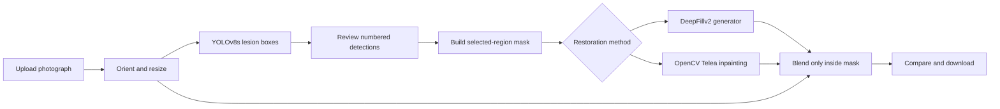
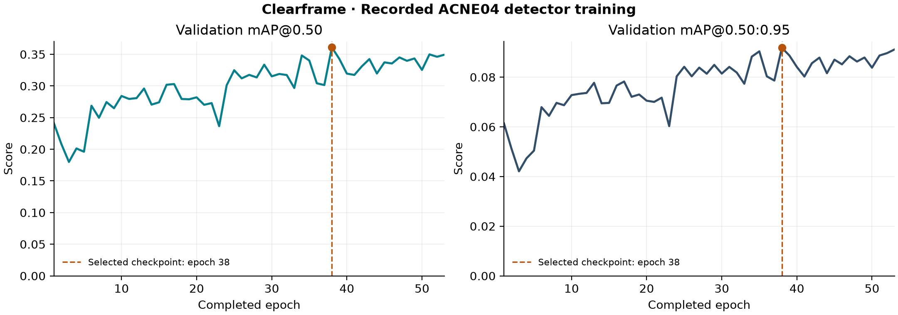

# Clearframe

### Local acne detection and selective photo retouching

**YOLOv8s · DeepFillv2 · OpenCV · Gradio · 6 GB GPU**

Clearframe finds acne-like spots, lets you review each detection, and retouches only the regions you select. It runs on your laptop, loads its models once, and reuses the saved weights for every new photograph.

The acne detector was fine-tuned locally on ACNE04. Restoration offers two approaches: a pretrained DeepFillv2 generator for learned texture completion, and OpenCV's Telea algorithm for fast filling from neighboring pixels.

> A photo editing and computer vision demonstration. Bounding boxes are not a medical diagnosis, and generated texture is not recovered ground truth.

## Contents

- [Quick start](#quick-start)
- [How it works](#how-it-works)
- [Why these methods](#why-these-methods)
- [DeepFill versus Fast](#deepfill-versus-fast)
- [Measured results](#measured-results)
- [Train on your laptop](#train-on-your-laptop)
- [Project layout](#project-layout)
- [Detailed documentation](#detailed-documentation)
- [Acknowledgments and license](#acknowledgments-and-license)

## Quick start

### Requirements

- Windows 10/11 with PowerShell and Git.
- An NVIDIA GPU with a working driver for CUDA mode; the demonstrated laptop has 6 GB VRAM and 16 GB RAM.
- Internet for dependency and optional DeepFill downloads. Normal image processing then runs locally.

The trained **22.5 MB acne checkpoint is included**. You do not need to download the dataset or retrain to try the app.

```powershell
git clone https://github.com/blackleg-sanji007/clearframe-acne-retouch.git
cd clearframe-acne-retouch
powershell -ExecutionPolicy Bypass -File .\setup.ps1
```

For both restoration modes, download the separately maintained DeepFill source and weights:

```powershell
.\.venv\Scripts\python.exe download_assets.py --deepfill
.\.venv\Scripts\python.exe demo.py
```

Open **http://127.0.0.1:7860**. Keep the process running while using the interface.

1. Upload a clear face photograph and click **Find spots**.
2. Review the numbered boxes. Deselect false positives or anything covering facial features you want to preserve.
3. Choose **DeepFillv2** or **Fast (OpenCV)** and click **Apply retouch**.
4. Drag the before/after divider; use the image and mask download controls to save results.

Start with confidence **0.25**, padding **2 px**, and strength **1.0**. Lower confidence can recover missed spots but also adds false positives. More padding removes a wider area, including healthy skin.

### CPU / Fast-only setup

```powershell
powershell -ExecutionPolicy Bypass -File .\setup.ps1 -CpuOnly
.\.venv\Scripts\python.exe demo.py --device cpu
```

Skip the DeepFill download to use **Fast (OpenCV)** alone. CPU inference is supported but its speed was not benchmarked. Additional flags include `--port 7861`, `--no-browser`, `--weights PATH`, and `--no-warmup`.

Setup creates a project-local Python 3.12 environment. It installs PyTorch 2.7.1 with CUDA 12.8 binaries by default; a separate CUDA toolkit installation is not required. A compatible NVIDIA driver is required. See [reproducibility and troubleshooting](docs/REPRODUCIBILITY.md).

## How it works



**Detection decides where to edit; inpainting proposes what to put there.** The detector does not generate skin, and the inpainting model does not identify acne. Your selected boxes connect these two stages.

Images are EXIF-oriented, converted to RGB, and bounded to 1600 px on the longest side. YOLO inference uses a 640 px target. DeepFill uses an aspect-preserving 512 × 512 canvas, then its result is resized back. Both restoration paths share the same mask and final inward feathering operation. Pixels outside that mask are copied exactly from the normalized working image.

The full [algorithm explanation](docs/ALGORITHM.md) covers the detector, gated convolutions, contextual attention, Telea's fast marching method, mask construction, and the blending equation.

## Why these methods

| Choice | Reason | Tradeoff |
| --- | --- | --- |
| YOLOv8s detector | A practical capacity and memory balance for a 6 GB GPU; a maintained training and inference implementation | Small lesions can still be missed; no local comparison against other YOLO sizes was run |
| COCO transfer learning | Reuses general visual features instead of learning everything from a small acne dataset | Pretraining is general-purpose, so acne-specific fine-tuning is still necessary |
| Single lesion class | ACNE04 boxes support the detection task used here | This demo does not classify lesion subtypes or diagnose severity |
| Pretrained DeepFillv2 | Adds learned completion without training another large network on the laptop | Its texture prior may not match the photograph and can produce artifacts |
| OpenCV Telea alternative | Provides a simple CPU-based restoration baseline without learned restoration weights | Larger or textured masks can look smooth or smeared |
| Reviewable boxes | Gives the user control before any region is changed | Adds one manual review step |
| Mixed precision, batch 8, workers 0 | Keeps the observed training workload within the laptop's GPU and system memory limits | Windows data loading can become the bottleneck |
| Local Gradio interface | A small demonstration needs an upload/review/compare flow without a separate web stack | This is a local demo, not a deployed multi-user service |
| Cached models and startup warmup | Pays loading and initialization costs once | Startup takes longer, and the loaded models occupy memory |

## DeepFill versus Fast

DeepFill can look better on patches where natural skin texture matters. Its gated convolutions learn which features to use, and its refinement stage combines learned generation with contextual attention to visible image features. Telea instead extends nearby image information inward from the boundary; it has no learned model of skin texture. On larger blemish masks, that local propagation can produce a visibly smooth patch.

This explains **why DeepFill can produce a more convincing visual result in the demo**. It is a mechanism-based interpretation, not a measured universal ranking: this project has no paired clean-face ground truth or formal human preference study. Telea can look better on tiny, smooth regions; DeepFill can invent texture, alter shading inside the mask, or lose detail through its 512 px working canvas.

| | DeepFillv2 | Fast (OpenCV) |
| --- | --- | --- |
| Core method | Learned two-stage gated generator with contextual attention | Telea fast marching inpainting |
| Restoration training here | None; uses an existing pretrained checkpoint | None; a non-neural algorithm |
| Source of replacement pixels | Learned features and visible-image context | Weighted estimates from nearby known pixels |
| Main strength | Plausible completion across more challenging masks | Simplicity and low restoration latency |
| Typical failure | Invented or inconsistent texture | Blurring and smearing |
| Warm sample restoration time | 0.69 s | 0.17 s |

The times above come from one sample on the demonstrated GPU laptop and exclude startup and detection. They are not a latency benchmark over the dataset. [Experimental details](docs/EXPERIMENTS.md) distinguish detection accuracy from restoration quality.

## Measured results

The detector was trained on **993 images**, validated on **283**, and evaluated on **143 held-out test images containing 1,859 lesions**. Exact-image deduplication left 1,419 unique photographs after removing 38 duplicates.

Training targeted 60 epochs and finished at **53** through early stopping with patience 15. **Epoch 38** supplied the best validation checkpoint.

| Test metric | Initial 2-epoch baseline | Final checkpoint |
| --- | ---: | ---: |
| mAP@0.50 | 0.2629 | **0.3860** |
| mAP@0.50:0.95 | 0.0638 | **0.0991** |
| Precision | 0.367 (rounded) | 0.4697 |
| Recall | 0.327 (rounded) | 0.4613 |

These are **lesion detection metrics**, not a percentage of photographs successfully retouched. The baseline values were recorded with fewer decimal places. Model selection used validation fitness, rather than the test scores.



The split is at image level. Patient identifiers are unavailable, so patient independence is not established. The 38 removed duplicates were byte-identical images; near-duplicate removal and demographic subgroup evaluation were not performed.

Evidence: [test metrics](reports/test_metrics.json), [per-epoch CSV](reports/training.csv), [split manifest](reports/split_manifest.json), and [model card](docs/MODEL_CARD.md).

## Train on your laptop

The included detector is already trained. To reproduce the preparation and run a new local fine-tuning job:

```powershell
.\.venv\Scripts\python.exe download_assets.py --dataset
.\.venv\Scripts\python.exe prepare_dataset.py
.\.venv\Scripts\python.exe train.py --epochs 60 --batch 8 --workers 0 --imgsz 640
```

Close the demo before training to free memory. The data preparation script converts Pascal VOC annotations into normalized YOLO boxes, validates image dimensions and boxes, deduplicates exact images, and makes a deterministic severity-stratified 70/20/10 split using seed 42. Dataset downloads and photographs are excluded from this repository.

`train.py` starts from COCO-pretrained `yolov8s.pt`, saves periodic and best checkpoints, and publishes the best detector as `models/acne.pt` when training finishes. Use `--no-publish` to preserve the included app weights during an experiment. The trained object is the **detector**; DeepFill is not trained by this command.

```powershell
# Resume an interrupted run; use the actual run folder printed by training.
.\.venv\Scripts\python.exe train.py --resume runs/detect/acne_local/weights/last.pt --epochs 60

# Fine-tune a completed checkpoint in a new run.
.\.venv\Scripts\python.exe train.py --model models/acne.pt --name acne_finetune --no-publish

# Evaluate your published checkpoint on the test split.
.\.venv\Scripts\python.exe evaluate.py --output outputs/test-metrics.json

# Automated checks; these do not require ACNE04 or DeepFill downloads.
.\.venv\Scripts\python.exe -m unittest discover -s tests -v
```

Full setup, checkpoint, interruption, and evaluation instructions are in [REPRODUCIBILITY.md](docs/REPRODUCIBILITY.md).

## Project layout

```text
clearframe-acne-retouch/
├── demo.py                   # Gradio upload/review/retouch interface
├── acne_demo/
│   ├── pipeline.py           # Cached detector, boxes, masks, restoration dispatch
│   └── inpainting.py         # DeepFill adapter, Telea, exact outside-mask copying
├── models/
│   ├── acne.pt               # Locally trained detector; included
│   └── acne.json             # Provenance, metrics, checksum
├── docs/                     # Algorithm, experiments, model card, reproduction
├── reports/                  # Portable training and evaluation evidence
├── tests/                    # Unit tests and optional running-app smoke check
├── download_assets.py        # Explicit dataset / DeepFill downloads
├── prepare_dataset.py        # Validation, deduplication, VOC-to-YOLO conversion
├── train.py                  # GPU fine-tuning and checkpoint publishing
├── evaluate.py               # Held-out detector evaluation
├── training_job.py           # Resume, evaluate, restart, and check a local job
├── setup.ps1                 # Project-local Windows environment setup
└── run_demo.ps1              # Convenience launcher
```

Python environments, datasets, downloaded third-party source, DeepFill weights, caches, uploaded photographs, and local output folders are ignored by Git. This repository has a fresh history and does not bundle the original course project's files or checkpoint.

## Detailed documentation

- [Algorithm and design rationale](docs/ALGORITHM.md)
- [Experiments, metrics, and what was not measured](docs/EXPERIMENTS.md)
- [Reproducibility, setup, and troubleshooting](docs/REPRODUCIBILITY.md)
- [Detector model card](docs/MODEL_CARD.md)
- [Third-party sources and acknowledgments](THIRD_PARTY_NOTICES.md)

Photos are processed on localhost without a public Gradio sharing link. Temporary image files are written under `.cache/gradio`; cache cleanup runs hourly while the app is running. This is not a guarantee of immediate deletion. Downloaded output resolution is the normalized working image, up to 1600 px on the longest side.

## Acknowledgments and license

The project direction was inspired by [Archit's EE604 Course Project](https://github.com/architk22/EE604-Course-Project). This is a standalone remake with its own interface, local training pipeline, tests, and documented experiment. It does not claim to invent YOLO, DeepFill, or Telea inpainting.

Technical foundations: [Ultralytics YOLOv8](https://docs.ultralytics.com/models/yolov8/), [Free-Form Image Inpainting with Gated Convolution](https://arxiv.org/abs/1806.03589), [Generative Image Inpainting with Contextual Attention](https://arxiv.org/abs/1801.07892), [OpenCV inpainting](https://docs.opencv.org/4.x/df/d3d/tutorial_py_inpainting.html), and the [ACNE04 authors' repository](https://github.com/xpwu95/LDL).

Project source is provided under [AGPL-3.0](LICENSE). External implementations, pretrained assets, and the ACNE04 dataset retain their respective terms. The dataset authors specify academic use. See [THIRD_PARTY_NOTICES.md](THIRD_PARTY_NOTICES.md) before redistributing external assets.
